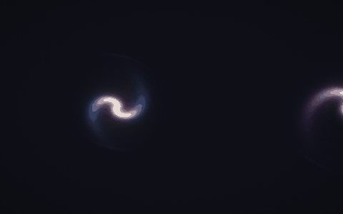
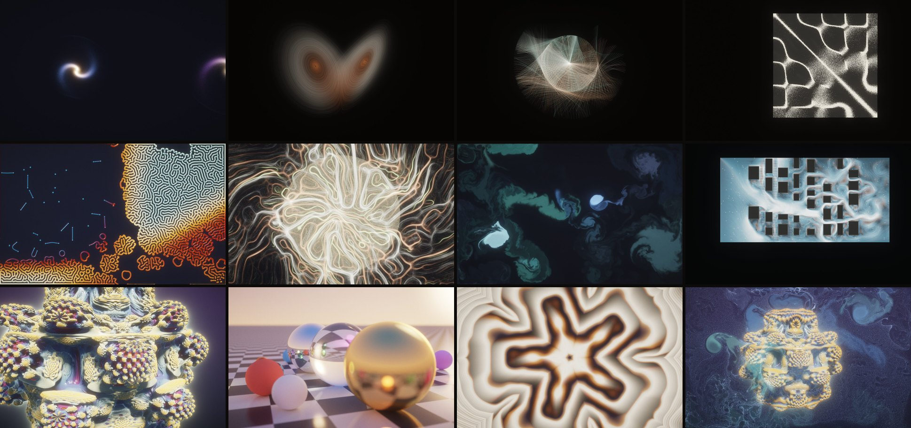
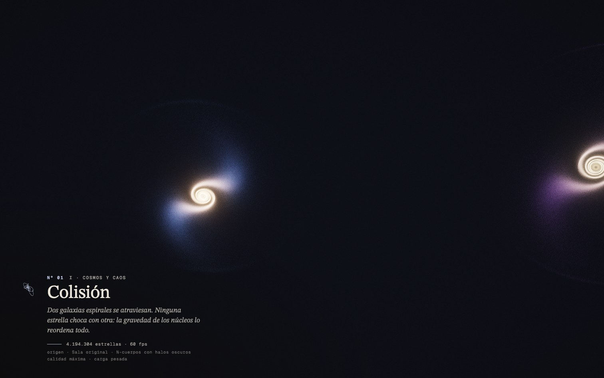
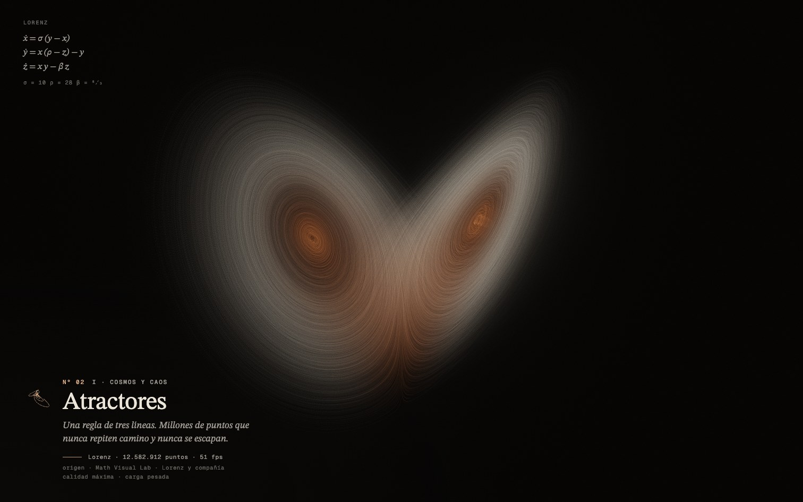
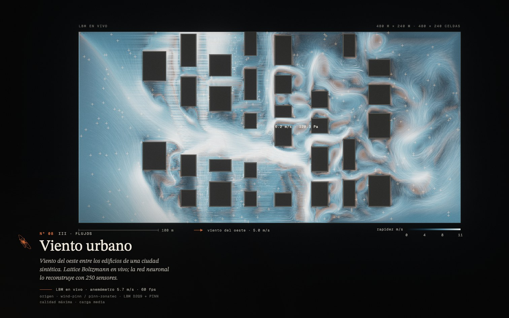
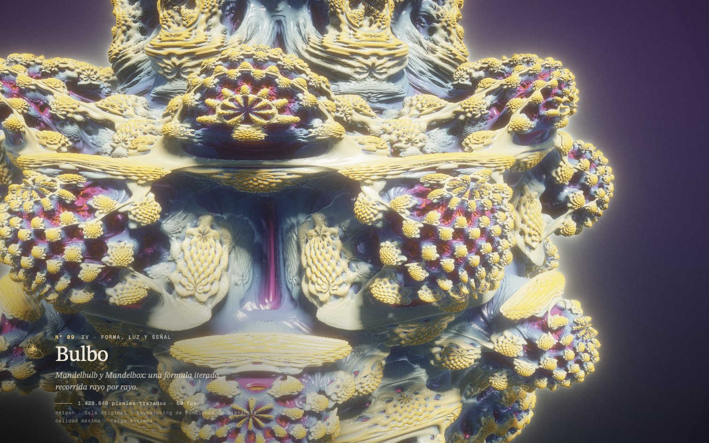
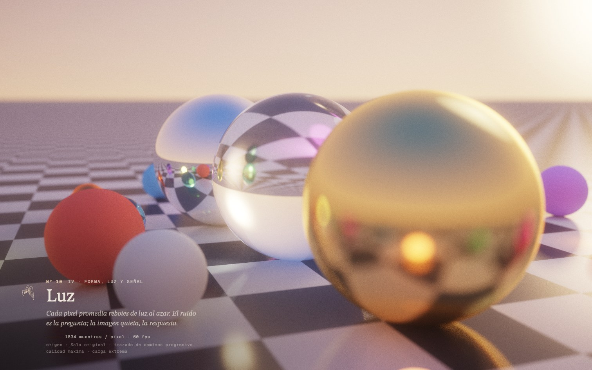
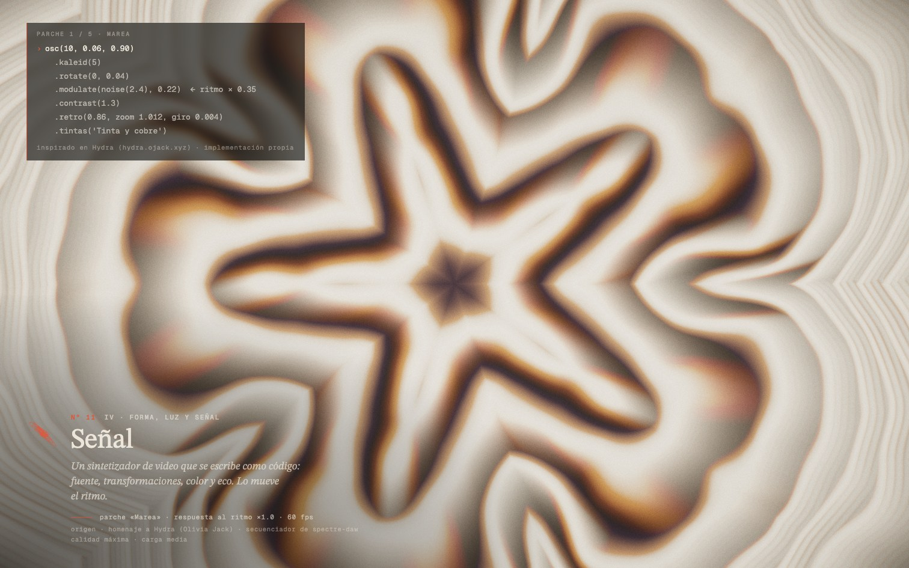

# UMBRAL · VX

*Visual eXperiments · tiempo real en tu navegador*

**Galería de cómputo pesado en el navegador.** Doce fenómenos simulados en tiempo real en la GPU con WebGPU: galaxias que chocan, atractores caóticos, fluidos, reacción-difusión, fractales, trazado de caminos y un sintetizador de video. Cada sala tiene su propia música generativa.



**[Abrir UMBRAL VX](https://umbral-vx.vercel.app)** (TODO: confirmar la URL de Vercel) · **[Ver el video del recorrido](TODO-enlace-al-video)** · [English below](#english)

> Necesita un navegador con WebGPU (Chrome o Edge recientes, Safari 26, Firefox reciente). Sin WebGPU, Umbral cambia a una versión WebGL2 de 7 salas. Si no hay ninguna de las dos, muestra el video y las láminas.

---

## Qué es

Umbral es una galería: entras a una antesala, eliges una sala y cada sala es una simulación que le pide algo distinto a la tarjeta gráfica. El nombre viene de esa idea, porque cada sala tiene un umbral de cómputo.

Antes de entrar, Umbral mide tu equipo en unos 3 segundos y te dice, sala por sala, si corre en calidad máxima, reducida o si no está disponible y por qué. En una computadora potente todo corre en máxima. En una laptop modesta corre lo que cabe, a la calidad que cabe.

Todo es estático: HTML, CSS y JavaScript sin dependencias ni paso de compilación. Los sombreadores WGSL van escritos a mano.

## Las salas



| Nº | Sala | Carga | Qué es |
|---|---|---|---|
| 01 | Colisión | pesada | Dos galaxias espirales que chocan: millones de estrellas en N-cuerpos con halos oscuros. |
| 02 | Atractores | pesada | Lorenz, Aizawa, Thomas, Halvorsen y Rössler con millones de puntos. Al cambiar de sistema, el nuevo flujo lleva las partículas a su atractor. |
| 03 | Péndulos | media | Miles de péndulos dobles casi iguales que divergen, un mapa de volteo y el rotor pateado de Chirikov. |
| 04 | Chladni | ligera | Arena sobre una placa que vibra. La arena se junta en las líneas nodales y la placa suena en la frecuencia de su modo. |
| 05 | Morfogénesis | pesada | Reacción-difusión de Gray-Scott: los patrones de Turing. |
| 06 | Plasmodio | pesada | Physarum: millones de agentes que siguen su propio rastro y tejen una red. |
| 07 | Tinta | media | Navier–Stokes incompresible con confinamiento de vorticidad. |
| 08 | Viento urbano | media | Lattice Boltzmann D2Q9 en vivo sobre una ciudad sintética, comparado con una red neuronal informada por física (PINN) evaluada en la GPU. |
| 09 | Bulbo | extrema | Mandelbulb y Mandelbox por raymarching. |
| 10 | Luz | extrema | Trazado de caminos progresivo: el ruido converge en una imagen. |
| 11 | Señal | media | Un sintetizador de video que se ve como código y se edita en vivo, movido por una máquina de ritmos de cinco estilos. |
| 12 | Ensamble | extrema | Un fractal, un fluido y dos millones de partículas en el mismo cuadro. |

<table>
<tr>
<td></td>
<td></td>
<td></td>
</tr>
<tr>
<td></td>
<td></td>
<td></td>
</tr>
</table>

## Controles

El esquema es el mismo en todas las salas. Funciona con teclado, ratón o mando (Xbox/PlayStation, mapeo estándar).

| Acción | Teclado | Mando |
|---|---|---|
| Sala anterior / siguiente | ← → | LB / RB |
| Modo de la sala | ↑ ↓ | cruceta ↑ ↓ |
| Acción de la sala | Enter | A |
| Pausa | Espacio | Select |
| Antesala | Esc o M | B o Start |
| Control propio 1 / 2 | WASD / IJKL | stick izquierdo / derecho |
| Intensidad | Q / E | LT / RT |
| Paleta | X | X |
| Acción secundaria | C | Y |
| Ir a la sala 1–10 | 1…9, 0 | — |
| Recorrido automático | P | — |
| Instrumentos (fps, GPU) / ocultar texto / sonido | I / H / N | — |
| Ayuda | ? | — |

Parámetros de la URL: `?sala=8` entra directo a una sala, `?recorrido=40` hace una presentación automática de 40 s por sala, `?medir` repite la medición del equipo, `?mudo` arranca en silencio, `?webgl` fuerza la versión WebGL2 y `?perfil=alto|medio|basico|debil|movil` simula otro equipo.

## Tecnología

- **WebGPU**: cómputo y render. Cada sala es una clase con sus sombreadores WGSL (`js/demos/`). Hay N-cuerpos, partículas, mallas de fluidos y LBM, raymarching y trazado de caminos.
- **WebGL2 de respaldo**: 7 salas simplificadas (`js/gl/fallback.js`) para navegadores sin WebGPU.
- **Audio generativo**: Web Audio sin muestras (`js/sonido.js`). Cada sala tiene una «partitura» que lee la simulación. En Atractores suena una nota cada vez que la trayectoria cruza el plano x = 0, y su altura sale de z. En Chladni suena la frecuencia del modo, el viento silba según su rapidez y Señal tiene un secuenciador de cinco estilos con forma de pista.
- **Post-proceso común**: negros cálidos, grano de película fino y bloom contenido.
- **Diseño**: STIX Two Text y Geist Mono. Cada sala tiene una firma de harmonógrafo y una ficha como la cédula de un museo.

## Rendimiento y equipos distintos

Umbral se adapta en tres pasos:

1. **Detección.** Revisa si hay WebGPU, los límites del adaptador y la clase de GPU según lo que reporta (Apple silicon, dedicada, integrada o por software). Si no hay WebGPU, prueba WebGL2.
2. **Medición** (unos 3 s, se guarda 30 días). Mide FP32 con FMA, el ancho de banda de memoria y un cuadro de prueba a 1080p. Con eso elige la calidad inicial de cada sala entre baja, media, alta y máxima, que cambian la resolución interna (50–100 %) y la carga (partículas, pasos, muestras).
3. **Gobernador.** Cada sala ajusta su carga en vivo según el tiempo de GPU. Si aun así el cuadro se pasa de presupuesto durante 5 s, Umbral baja un preset completo y lo recuerda.

Medido en un MacBook (Apple M5) a 1512×945: unos 3.1–3.8 TFLOP/s, las 12 salas en calidad máxima a 58–60 fps. El render tiene un tope de 60 fps (`?fps=` lo cambia). Cuando la ventana pierde el foco, Umbral se pausa y suelta la GPU.

## Correrlo en tu equipo

No hace falta instalar nada. Basta un servidor estático, porque los módulos ES no cargan desde `file://`:

```sh
npx serve .                 # o bien:
python3 -m http.server 8000
```

Abre `http://localhost:3000` (o `:8000`). WebGPU necesita un contexto seguro: `localhost` o HTTPS. GitHub Pages ya sirve por HTTPS.

## Créditos

- Diseño, simulaciones, sonido y código: **Hermann**.
- *Señal* es un homenaje a **Hydra** de Olivia Jack. La implementación es propia.
- *Viento urbano* reutiliza la geometría, los sensores y los pesos de la PINN de mi proyecto wind-pinn. La voz del sintetizador y el secuenciador vienen de mi sinte spectre-daw.
- Tipografías: **STIX Two Text** (STI Pub Companies) y **Geist Mono** (Vercel), ambas con licencia SIL Open Font License 1.1.
- Gray-Scott, Physarum (Jeff Jones), fluido estable (Jos Stam), Lattice Boltzmann, Mandelbulb (Daniel White y Paul Nylander) y Mandelbox (Tom Lowe) son las ideas sobre las que se construyen las salas.

## Licencia

**TODO (Hermann): confirmar la licencia.** La sugerencia es MIT para el código (ver `LICENCIA-PENDIENTE.md`). Las fuentes conservan su licencia OFL.

---

<a id="english"></a>

## English

**UMBRAL · VX** (*umbral* is Spanish for threshold; VX = Visual eXperiments) is a heavy-compute gallery for the browser: twelve real-time GPU simulations built with WebGPU, each with its own generative soundtrack. It includes colliding galaxies, chaotic attractors, double pendulums, Chladni plates, Gray-Scott reaction–diffusion, Physarum, Navier–Stokes ink, a Lattice Boltzmann wind tunnel compared live against a physics-informed neural network, Mandelbulb/Mandelbox raymarching, a progressive path tracer and a live-coded video synth.

**[Open UMBRAL VX](https://umbral-vx.vercel.app)** · **[Watch the showcase video](TODO-enlace-al-video)**

- **Adapts to your hardware.** On first load it detects WebGPU and the adapter class, then runs a ~3 s benchmark (FP32 FMA, memory bandwidth and a 1080p frame test). From that it picks a starting quality for each room. An in-room governor tunes particle counts and steps, and a global governor drops a full preset if frames stay over budget. On an Apple M5 every room runs at max quality at 60 fps.
- **Fallbacks.** Without WebGPU it switches to a 7-room WebGL2 version. Without either, it shows a polite page with the showcase video and stills.
- **Generative audio.** Web Audio only, no samples. The sound reads the simulation, for example a note on every Poincaré-section crossing in the attractors.
- **No build step.** Plain ES modules and hand-written WGSL. Serve the folder with any static server (`npx serve .`) or GitHub Pages.

**Controls:** ← → change room, ↑ ↓ room mode, Enter action, Space pause, Esc lobby, WASD/IJKL room controls, P auto-tour. Gamepads are supported.

**Credits:** design, simulations, sound and code by Hermann. *Señal* is an homage to Hydra by Olivia Jack, with its own implementation. Fonts: STIX Two Text and Geist Mono (SIL OFL 1.1).

**License:** TODO, pending confirmation (MIT suggested).
