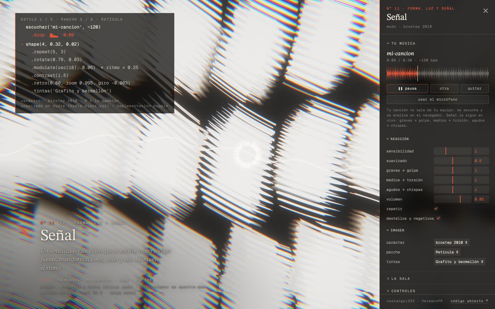
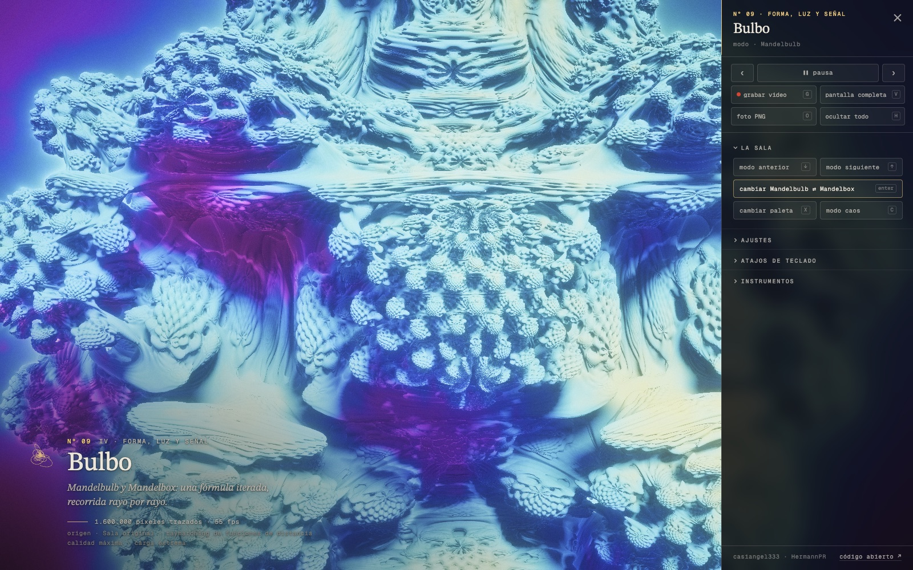

# UMBRAL · VX

*Visual eXperiments — twelve real-time GPU simulations in your browser, each with its own generative sound.*


**[▶ Open UMBRAL VX](https://umbral-vx.vercel.app)** · **[Watch the 60 s showcase](media/umbral-vx-promo.mp4)** · [Español abajo](#español)

by **casiangel333** ([HermannPR](https://github.com/HermannPR)) · MIT

> Needs a browser with WebGPU (recent Chrome or Edge, Safari 26, recent Firefox). Without WebGPU it switches to a 7-room WebGL2 version; with neither, it shows the video and stills.

---

## What it is

A gallery for heavy compute. You enter a lobby, pick a room, and each room is a simulation that asks something different of your GPU: colliding galaxies, chaotic attractors, double pendulums, Chladni plates, Gray–Scott reaction–diffusion, Physarum, Navier–Stokes ink, a Lattice Boltzmann wind tunnel compared live against a physics-informed neural network, Mandelbulb/Mandelbox raymarching (with an infinite deep-zoom Mandelbrot), a progressive path tracer and a live-coded video synth.

*Umbral* is Spanish for *threshold*: every room has its own compute threshold, and the gallery measures yours before you go in.


## New in this version

- **Bring your own music.** Drop an audio file anywhere on the page (or use the mic) and the *Señal* room listens and follows it: bass → hits, mids → twist, highs → sparks. Your song never leaves your machine — it is decoded and analysed in the browser.
- **Señal hears the whole song first.** While it starts playing, the song is analysed offline (own code, no dependencies): beat grid with phase and downbeats, build-ups, the silence before each drop, the drops themselves, and the key bar by bar (chroma + Krumhansl profiles). Visuals then read that map at the exact moment you hear it, so hits land on the beat and a build-up knows how far the drop is. Tempo ×2 / ÷2 if it guesses double or half.
- **Colour that follows the music.** Palettes rotate with the key (circle of fifths), on every drop, every bar, or as a slow rainbow. Scenes can change by themselves — on every drop, per section, or every 8/16 bars — melting into each other through the feedback loop.
- **More visuals.** 13 patches (8 new: Túnel, Sol negro, Topografía, Espejo, Vórtice, Cristal, Ondas, Latido), new sources (rings, rays, checkerboard), tunnel/waves/bulge/mirror geometry, solarize and contour lines, plus compositing effects: radial zoom on hits, monitor scanlines, screen mirror, datamosh and a drop strobe (off when *flashes* are off).
- **Record video.** `G` records what you see and hear (MP4 H.264 + AAC where the browser can, WebM otherwise). Pick a canvas format — screen, vertical 9:16 1080×1920 for Reels/TikTok, 16:9 1920×1080 or 1:1 — and *record the whole song* runs it from 0:00 to the end and downloads the file. Recording works in every room. A stage mode hides all text and goes fullscreen.
- **A side panel that stays.** Controls, room actions, your music and view settings live in a collapsible panel (built on [lil-gui](https://lil-gui.georgealways.com)). Nothing fades away before you can read it: open it with `?`, close it with `×`, it remembers its state.
- **Capture and share.** `O` saves a full-resolution PNG of the current frame, `V` goes fullscreen, and the panel copies a direct link to the room.
- **Calmer palettes.** The *Bulbo* colour grades were rebalanced so the cyclic and two-tone palettes keep the shape readable instead of burning out.
- **New generative music** for the lobby and reworked melodies in *Señal*.

| Your music in *Señal* | The panel in *Bulbo* |
|---|---|
|  |  |

## The rooms

| Nº | Room | Load | What it is |
|---|---|---|---|
| 01 | Colisión | heavy | Two spiral galaxies colliding: millions of stars, N-body with dark halos. |
| 02 | Atractores | heavy | Lorenz, Aizawa, Thomas, Halvorsen and Rössler with millions of points; switching systems lets the new flow carry the particles to its attractor. |
| 03 | Péndulos | medium | Thousands of near-identical double pendulums diverging, a flip map and Chirikov's kicked rotor. |
| 04 | Chladni | light | Sand on a vibrating plate gathers on the nodal lines; the plate sings at its mode's frequency. |
| 05 | Morfogénesis | heavy | Gray–Scott reaction–diffusion: Turing patterns. |
| 06 | Plasmodio | heavy | Physarum: millions of agents following their own trail weave a network. |
| 07 | Tinta | medium | Incompressible Navier–Stokes with vorticity confinement. |
| 08 | Viento urbano | medium | Live Lattice Boltzmann D2Q9 over a synthetic city, compared with a PINN evaluated on the GPU. |
| 09 | Bulbo | extreme | Mandelbulb and Mandelbox raymarching, plus an infinite-zoom Mandelbrot. |
| 10 | Luz | extreme | Progressive path tracing: noise converging into an image. |
| 11 | Señal | medium | A video synth that reads like code and is edited live, driven by a five-style drum machine — or by your own song. |
| 12 | Ensamble | extreme | A fractal, a fluid and two million particles in the same frame. |

## Controls

Same scheme in every room. Keyboard, mouse or gamepad (Xbox/PlayStation, standard mapping).

| Action | Keyboard | Gamepad |
|---|---|---|
| Previous / next room | ← → | LB / RB |
| Room mode | ↑ ↓ | D-pad ↑ ↓ |
| Room action | Enter | A |
| Pause | Space | Select |
| Lobby | Esc | B / Start |
| Room controls 1 / 2 | WASD / IJKL | left / right stick |
| Intensity | Q / E | LT / RT |
| Palette / secondary action | X / C | X / Y |
| Jump to room 1–10 | 1…9, 0 | — |
| **Open / close the panel** | **?** | — |
| Instruments (fps, GPU) · hide all text · sound | T · H · N | — |
| Fullscreen · save PNG · record video | V · O · G | — |
| Auto-tour | P | — |
| Load your own song | drag & drop an audio file | — |

URL parameters: `?sala=11` opens a room directly, `?recorrido=40` runs a 40 s-per-room tour, `?medir` re-runs the hardware benchmark, `?mudo` starts muted, `?webgl` forces the WebGL2 version, `?perfil=alto|medio|basico|debil|movil` simulates another machine.

## How it adapts to your hardware

1. **Detect.** WebGPU support, adapter limits and GPU class (Apple silicon, discrete, integrated, software). No WebGPU → try WebGL2.
2. **Measure** (~3 s, cached for 30 days). FP32 FMA throughput, memory bandwidth and a 1080p test frame pick a starting quality per room (low / medium / high / max: internal resolution 50–100 % plus particle, step and sample counts).
3. **Govern.** Each room tunes its load live from GPU time; if frames stay over budget for 5 s, the gallery drops a whole preset and remembers it.

On an Apple M5 MacBook at 1512×945 (~3.1–3.8 TFLOP/s) all twelve rooms run at max quality at 58–60 fps. Rendering is capped at 60 fps (`?fps=` changes it), and the gallery pauses and releases the GPU when the window loses focus.

## Tech

- **WebGPU** compute + render, one class per room with hand-written WGSL (`js/demos/`): N-body, particles, fluid grids and LBM, raymarching, path tracing.
- **WebGL2 fallback**: 7 simplified rooms (`js/gl/`).
- **Generative audio** with Web Audio and no samples (`js/sonido.js`). Each room has a *score* that reads the simulation — a note on every Poincaré-section crossing in *Atractores*, the mode frequency in *Chladni*, wind that whistles with its speed. `js/pista.js` follows your own songs live; `js/analisis.js` maps the whole song offline (FFT, spectral flux, Ellis-style dynamic-programming beat tracking, sections, key).
- **Video capture** with `canvas.captureStream` + `MediaRecorder` (`js/grabar.js`), audio tapped from the final mix.
- **No build step, no dependencies to install.** Plain ES modules; the only vendored library is lil-gui.

## Run it locally

ES modules don't load from `file://`, so serve the folder with any static server:

```sh
npx serve .
# or
python3 -m http.server 8000
```

Open `http://localhost:3000` (or `:8000`). WebGPU needs a secure context: `localhost` or HTTPS.

## Credits

- Design, simulations, sound and code: **casiangel333** ([HermannPR](https://github.com/HermannPR)).
- *Señal* is an homage to [Hydra](https://hydra.ojack.xyz) by Olivia Jack, with its own implementation.
- The rooms build on Gray–Scott, Physarum (Jeff Jones), Stable Fluids (Jos Stam), Lattice Boltzmann, the Mandelbulb (Daniel White and Paul Nylander) and the Mandelbox (Tom Lowe).
- Panel UI: [lil-gui](https://lil-gui.georgealways.com) by George Michael Brower (MIT).
- Fonts: **STIX Two Text** and **Geist Mono**, SIL Open Font License 1.1.

## License

Code: [MIT](LICENSE) © 2026 casiangel333 (HermannPR). Fonts keep their OFL license (`fuentes/OFL.txt`); see [THIRD-PARTY-NOTICES.md](THIRD-PARTY-NOTICES.md).

---

<a id="español"></a>

## Español

**UMBRAL · VX** es una galería de cómputo pesado: doce fenómenos simulados en tiempo real en la GPU con WebGPU, cada uno con su música generativa. Entras a una antesala, eliges una sala y cada sala le pide algo distinto a tu tarjeta gráfica. Antes de entrar, Umbral mide tu equipo en unos 3 segundos y te dice, sala por sala, a qué calidad corre.

**[▶ Abrir UMBRAL VX](https://umbral-vx.vercel.app)** · **[Ver el video (60 s)](media/umbral-vx-promo.mp4)**

**Lo nuevo**

- **Tu propia música.** Suelta un archivo de audio en cualquier parte de la página (o usa el micrófono) y la sala *Señal* lo escucha y lo sigue: graves → golpe, medios → torsión, agudos → chispas, con detección de tempo y de drops. Ajusta sensibilidad, suavizado y cada banda desde el panel. Tu canción no sale de tu equipo.
- **Un panel lateral que no se va solo.** Controles, acciones de la sala, tu música y la vista viven en un panel plegable. Ábrelo con `?`, ciérralo con `×`; recuerda cómo lo dejaste.
- **Señal escucha la canción completa.** Mientras empieza a sonar, la analiza entera: pulsos, tiempo fuerte, subidas, el silencio antes del drop, los drops y la tonalidad compás por compás. La imagen lee ese mapa en el instante que oyes. Si el tempo sale al doble o a la mitad, ×2 / ÷2.
- **Color que sigue la música** (tonalidad en la rueda de quintas, cada drop, cada compás o arcoíris) y **escenas automáticas** (en cada drop, por sección o cada 8/16 compases).
- **Más visuales:** 13 parches (8 nuevos), fuentes nuevas, túnel, ondas, esfera, espejo, solarizar, curvas de nivel, zoom radial, líneas de monitor, datamosh y estrobo.
- **Graba video:** `G` graba lo que ves y oyes (MP4 o WebM). Formatos: pantalla, vertical 9:16 1080×1920, 16:9 o 1:1; «grabar la canción completa» va de 0:00 al final y descarga sola. Modo escenario: sin texto y en pantalla completa.
- **Captura y comparte.** `O` guarda un PNG del cuadro, `V` pone pantalla completa y el panel copia el enlace directo a la sala.
- **Paletas más sobrias** en *Bulbo* y **música nueva** en la antesala y en *Señal*.

**Controles:** ← → sala, ↑ ↓ modo, Enter acción, Espacio pausa, Esc antesala, WASD/IJKL controles de la sala, Q/E intensidad, X paleta, C acción secundaria, `?` panel, T instrumentos, H ocultar texto, N sonido, V pantalla completa, O guardar PNG, G grabar video, P recorrido automático. Funciona con mando.

**Correrlo:** `npx serve .` o `python3 -m http.server 8000` y abre `localhost`.

**Créditos:** diseño, simulaciones, sonido y código de **casiangel333** (HermannPR). *Señal* es un homenaje a Hydra de Olivia Jack, con implementación propia. Panel con lil-gui (MIT). Tipografías STIX Two Text y Geist Mono (SIL OFL 1.1).

**Licencia:** código MIT © 2026 casiangel333 (HermannPR). Las fuentes conservan su licencia OFL.
